# Existing browser state machines

Browser workflows combine React state, refs, query/mutation status, storage, timers and external SDK callbacks. The backend remains authoritative for financial settlement, permissions and durable business changes. The [backend map](../../BelivrHQ-Backend/docs/STATE-MACHINES.md) documents those server lifecycles and their B identifiers.

Snapshot: 14 November 2026, updated with the [transition corrections](../../BelivrHQ-Backend/docs/STATE-TRANSITION-FIXES-2026-11-14.md). F identifiers are documentation references, not new application types. Diagram names such as Restoring and Verifying describe combinations of existing values; they are not claims that the code already declares a corresponding enum.

## Machine index

- [F01 Browser session](#f01-browser-session)
- [F02 Session refresh and request recovery](#f02-session-refresh-and-request-recovery)
- [F03 Login challenge and recovery presentation](#f03-login-challenge-and-recovery-presentation)
- [F04 Registration wizard](#f04-registration-wizard)
- [F05 Password reset and invitation acceptance](#f05-password-reset-and-invitation-acceptance)
- [F23 Authenticator settings](#f23-authenticator-settings)
- [F06 Checkout window and verification](#f06-checkout-window-and-verification)
- [F07 Direct media upload](#f07-direct-media-upload)
- [F08 People import wizard](#f08-people-import-wizard)
- [F09 Sermon editor](#f09-sermon-editor)
- [F22 Public and member form submission](#f22-public-and-member-form-submission)
- [F10 Bot verification](#f10-bot-verification)
- [F11 Support widget](#f11-support-widget)
- [F12 Assistant access and conversation](#f12-assistant-access-and-conversation)
- [F17 Live call confirmation](#f17-live-call-confirmation)
- [F13 Unsaved edits](#f13-unsaved-edits)
- [F14 Shared dialogs mutation screens and exports](#f14-shared-dialogs-mutation-screens-and-exports)
- [F15 Bulk record management](#f15-bulk-record-management)
- [F16 Attendance roster batch save](#f16-attendance-roster-batch-save)
- [F18 Vault storage and offline lease](#f18-vault-storage-and-offline-lease)
- [F19 Offline mutations and F20 synchronization flight](#f19-offline-mutations-and-f20-synchronization-flight)
- [F21 Service worker and offline navigation](#f21-service-worker-and-offline-navigation)

## Reading the maps

- **Local** state includes component state, refs and module variables. Remounts/reloads can reset it.
- **Durable** browser state includes IndexedDB and storage; server cookies are accessed through the session/billing endpoints rather than a readable client token.
- **Query** and **mutation** status belongs to the query library. It can coexist with the domain state, for example a failed request while a payment is still pending.
- Transition tables show guards, effects and retry paths. They do not imply compare-and-set protection unless the source actually supplies it.
- Shared UI patterns are grouped by behavior. Filter values, sorting, tabs, theme choices and open/closed presentation controls do not each become separate domain workflows.

## Session and account workflows

### F01 Browser session

**Owner:** [AuthProvider](../src/hooks/use-auth.tsx#L46). **Local:** user, token marker, loading flag, logout flag, timer and session generation. **Server:** cookie-backed session, profile and approval.

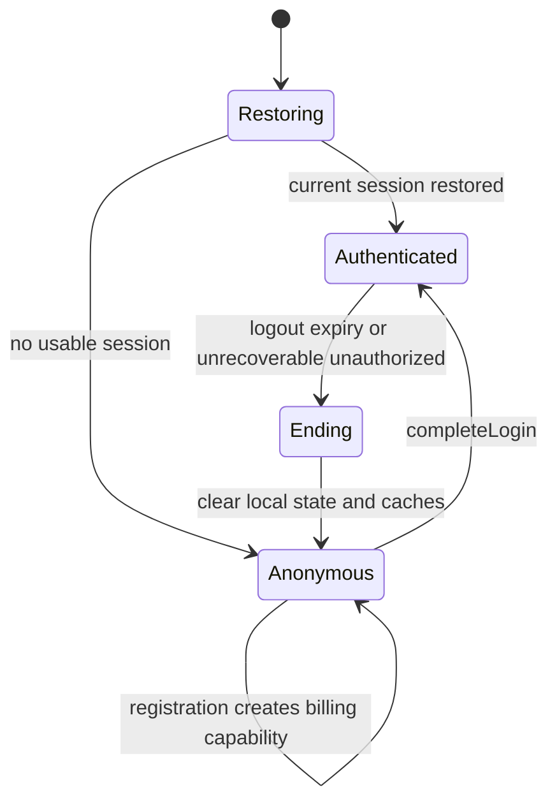

| Event | Guard and effect |
| --- | --- |
| Restore | Session generation and lifecycle cancellation prevent an old request from completing into a newer session. Profile/session responses hydrate user and permissions. |
| Complete login | Establish cookie session, populate user, use the server-session marker and schedule expiry handling. The marker is not a bearer token. |
| End session | Invalidate generation, stop timer, clear user/token and authorization/query state; protect concurrent logout handling with a ref. |
| Register | Clear ordinary client auth state and proceed with a purpose-bound registration billing flow. Account creation is not automatic workspace login. |

Session validity additionally depends on backend B25/B44 and entitlement guards. `isLoading=false` is not independently evidence of authentication.

### F02 Session refresh and request recovery

**Owner:** [api.ts](../src/lib/api.ts#L79). **Local:** module `refreshPromise`, `authGeneration`, per-request refresh allowance. **Cross-tab:** navigator lock when available.

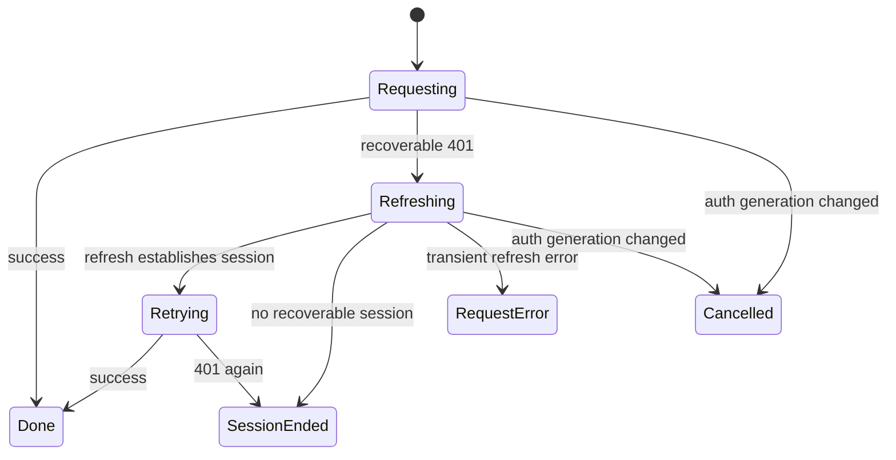

The shared promise deduplicates simultaneous refreshes; a browser lock serializes supported cross-tab rotations. Retry occurs at most once for a request. Transient refresh/server failures propagate as errors rather than proving logout. Blob helpers have equivalent recovery paths. A 402 can navigate to subscription; plan-limit errors dispatch a UI event, separately from ending authentication.

### F03 Login challenge and recovery presentation

**Owner:** [login page](../src/app/%28auth%29/login/page.tsx#L41), [auth hooks](../src/hooks/use-auth.tsx). **Local:** `otpStep`, challenge token, migration/providerMigration, setup payload, useRecovery and recoverySession; mutation states are separate.

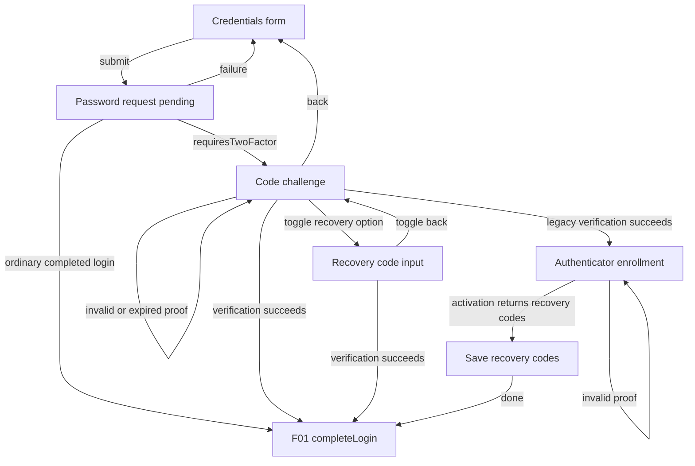

| Branch | Guard and effect |
| --- | --- |
| Password | Bot protection readiness and form validation; receiving a two-factor response clears the password and records the challenge method. |
| Verify | TOTP input is six digits; recovery input has the saved code format. Token/email fields depend on migration path. Invalid proof stays in the current screen. |
| Legacy migration | Verification can return a new challenge/setup instead of a usable completed login. Supabase and older email migration are distinct server branches. |
| Recovery-code display | Retain returned session in recoverySession until the user finishes saving codes, then finish login. |
| Back | Reset challenge/setup/migration/input values before returning to credentials. |

The booleans are not a validated discriminated union. This diagram describes branches taken by handlers, not proof that every possible combination of values is reachable or valid. Server challenge/approval machines are B42 through B45.

### F04 Registration wizard

**Owner:** [register page](../src/app/%28auth%29/register/page.tsx#L39), [registration mutation](../src/hooks/use-auth.tsx#L273). **Local:** numeric step, details, selection, legal acceptance, error, created flag and mutation state.

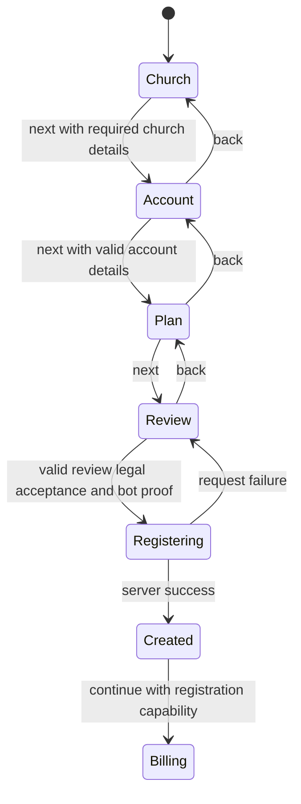

The steps are Your church, Your account, Your plan and Review. Validation blocks advancement/submission; query parameters can preselect plan/cycle/currency. Account creation clears ordinary auth state. Verified payment finishes this registration flow at login rather than granting an implicit workspace session. Backend payment/application/access remain B01 through B08.

### F05 Password reset and invitation acceptance

**Owner:** [reset password](../src/app/%28auth%29/reset-password/page.tsx), [accept invitation](../src/app/%28auth%29/accept-invitation/page.tsx). **Local:** token initialization, password/confirmation, validation errors and mutation state.

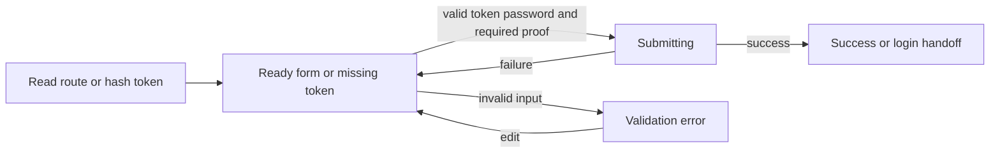

Reset reads its token from search parameters; invitation acceptance initializes from its fragment and marks readiness. Token presence is not proof of validity: the server validates it. Client validation includes password length/matching; bot readiness applies to the protected operation. Failure retains a retryable form. These are separate entry points sharing a pattern, not a shared persisted client workflow.

### F23 Authenticator settings

**Owner:** [security settings](../src/app/%28paper%29/settings/security/page.tsx#L141). **Local:** action idle/enroll/disable, setupData, input code, recovery display and query/mutation status.

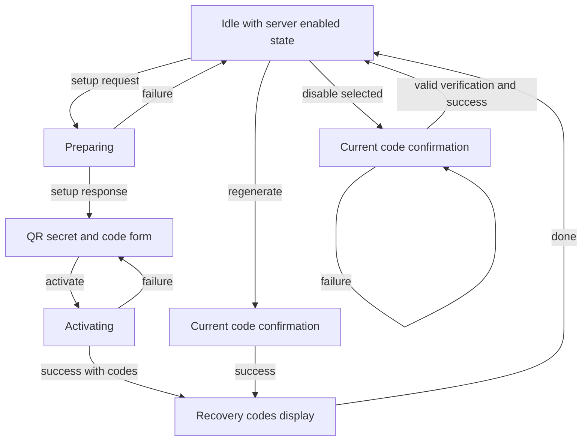

Enabled state is projected from verified factor/profile, not the action variable alone. Successful enrollment clears setup state and exposes recovery codes; regeneration invalidates old codes on the server. Closing or leaving a local setup panel does not itself consume or invalidate every server challenge. Backend B43/B44/B45 owns activation, approval and code consumption.

## Payment coordination

### F06 Checkout window and verification

**Owner:** [subscription page](../src/app/%28auth%29/subscription/page.tsx#L97), [paymentOutcome](../src/lib/payment-confirmation.ts), [cross-tab hints](../src/lib/payment-sync.ts), [popup helpers](../src/lib/subscription-checkout.ts), [return page](../src/app/payment/complete/page.tsx).

**Local:** tracked reference, popup/preparation refs, confirmation ref, registration completion ref and queries/mutations. **Recovery:** server pending attempt plus per-church sessionStorage reference. A cross-tab hint requests verification rather than proving success.

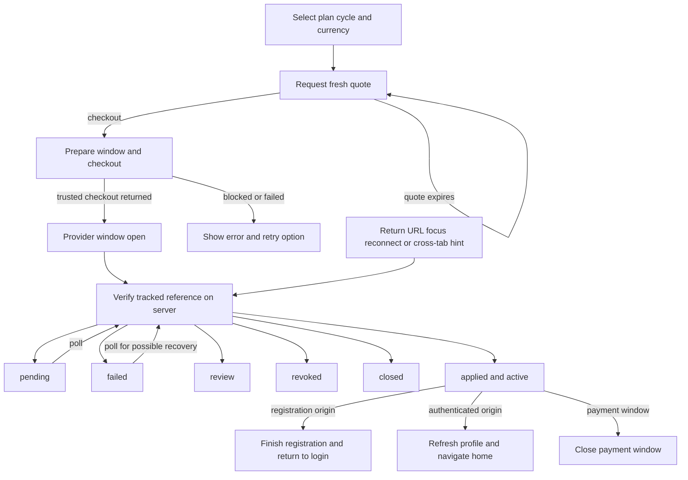

| State/event | Exact behavior |
| --- | --- |
| Outcome projection | Precedence: application revoked; application review; success + applied + active; closed pending checkout; failed/reversed; otherwise pending. It combines application, charge and access rather than one status. |
| Polling | Stops for applied/review/closed/revoked. Pending and failed continue; normal interval is 5 seconds and error interval 15 seconds, including background tab verification. |
| Provider successful return | A returning payment popup may close itself before fetching billing. The originating tab still verifies server state. A cancelled return displays a message; it is not itself server checkout cancellation. |
| Applied | Confirmation ref suppresses repeated handoff; clear saved reference, publish hint, close popup and finish registration or refresh profile/navigate home. |
| Close attempt | Server mutation closes B02; clear local reference and update billing query. Closure does not assert that no money can arrive later. |
| Reload or blocked storage | Recover pending reference from the server; storage is optional assistance, not authority. |
| Manage renewal | Independent management panel/mutation saves B09 preference. It is not payment success. |

The diagram separates local request failure from financial failure. The super-admin payment-history action resolves eligible unapplied payments through the separate application-review endpoint in B03. It requires an explicit reason, offers renewal application or revocation, and never offers applying a stale prorated upgrade. Ordinary billing administrators and registration sessions cannot use this action. An adjustment hold remains a different review path.

## Uploads imports and form entry

### F07 Direct media upload

**Owner:** [directMediaUpload](../src/lib/direct-media-upload.ts). **Local:** WeakMap keyed by File holding a completed transfer grant/folder/branch; the server owns the signed ticket and asset.

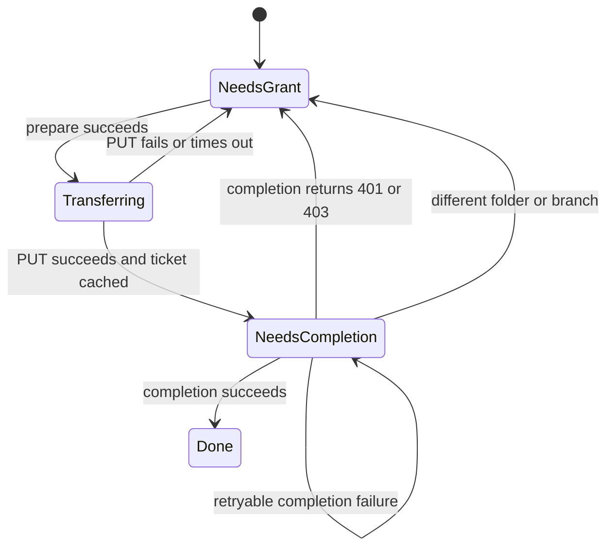

Validate nonempty file and 50 MB ceiling; require secure upload URL. Storage PUT omits credentials and has a ten-minute timeout. A completion retry for the same File/scope skips the already successful PUT. Grant rejection clears the cache so the next try prepares again; success also clears it. Reloading or replacing the File loses this in-memory optimization. Server B46 validates file metadata and idempotently registers the asset.

### F08 People import wizard

**Owner:** [PeopleImportPage](../src/components/shared/people-import-page.tsx#L137). **Local:** step, file rows/headers, field mapping, preview/dry-run result, final result and pending/error state.

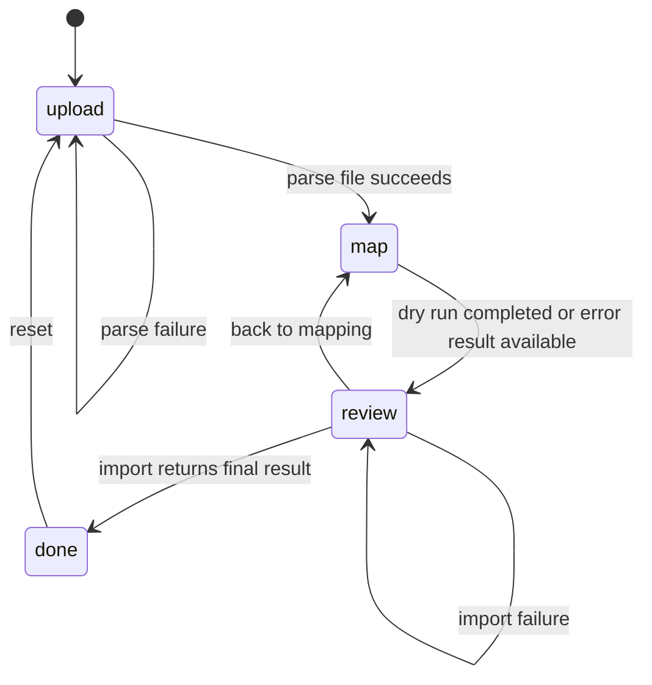

Dry run is a distinct request from applying an import. Parsed rows and mapping persist across the relevant steps; reset clears working results and returns to upload. Mapping/validation and permissions constrain execution. Final result may include per-row failures; reaching done is not a claim that every row was imported. Members and visitors reuse this workflow.

### F09 Sermon editor

**Owner:** [SermonForm](../src/components/sermons/sermon-form.tsx#L87), [recording draft validation](../src/lib/sermon-recording.ts), [upload field](../src/components/sermons/media-upload-field.tsx).

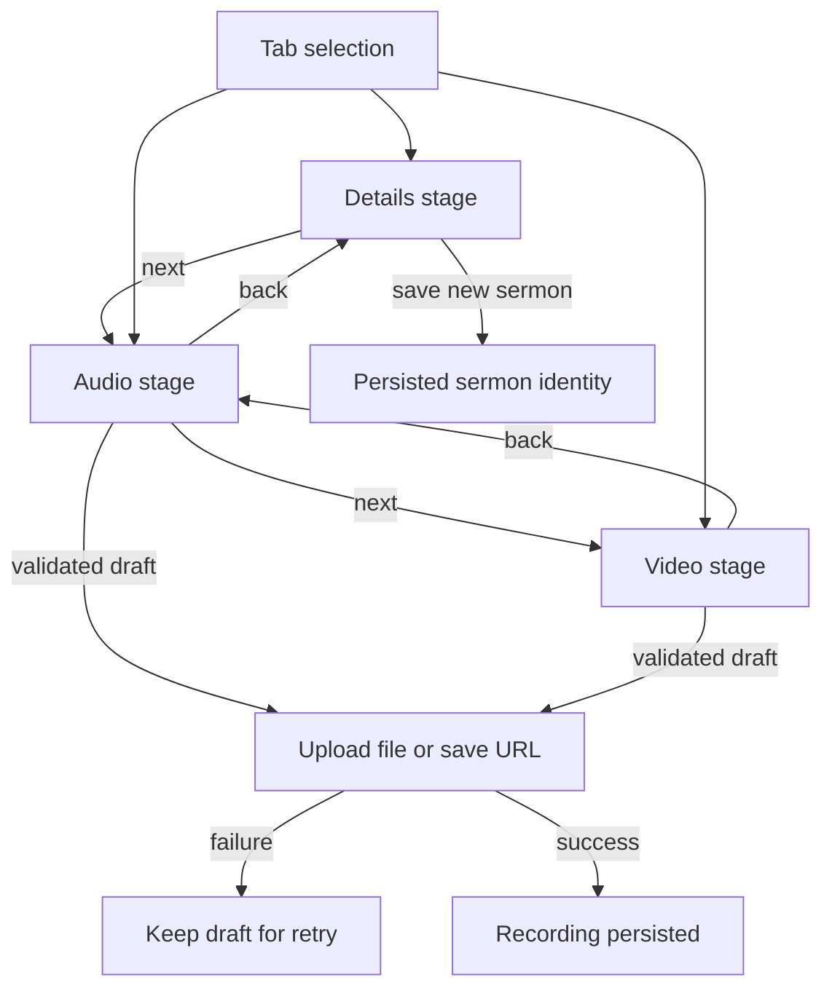

Stage is navigation, not a strict required sequence: tabs can select stages. Audio/video each retain URL/file/mode drafts. File MIME/size and URL validation precede save; details and recording writes are independent. A persisted sermon can survive a recording failure. Direct transfers use F07. Dirty navigation protection is F13.

### F22 Public and member form submission

**Owner:** [member fill](../src/app/%28paper%29/library/forms/%5BformId%5D/fill/page.tsx), [public form](../src/app/forms/public/%5BpublicToken%5D/page.tsx), [attachments](../src/components/forms/submission-attachments.tsx).

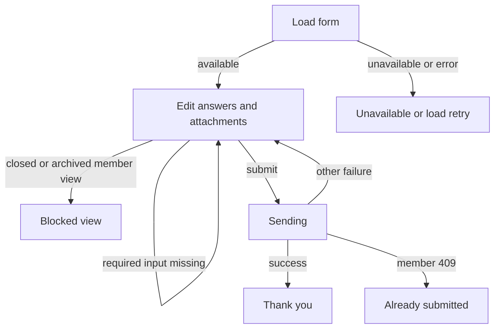

The member screen derives `notFillable` from closed or archived and validates required values. The backend additionally requires published, so a draft that reaches the member editor can still be rejected at submit; UI availability and server acceptance are different predicates. Member 409 uses the already-submitted result. Public form loading, sending, submission failure and retry use independent flags; bot verification and server public-token rules apply there. Attachment uploads are separate work and must complete to provide asset IDs. Backend publication/review are B19/B20; public people intake is B18.

## External widgets and request lifecycles

### F10 Bot verification

**Owner:** [BotProtection component](../src/components/shared/bot-protection.tsx), [readiness hook](../src/hooks/use-bot-protection.ts), [server replay rules](../../BelivrHQ-Backend/docs/STATE-MACHINES.md#b47-bot-challenge-replay-protection).

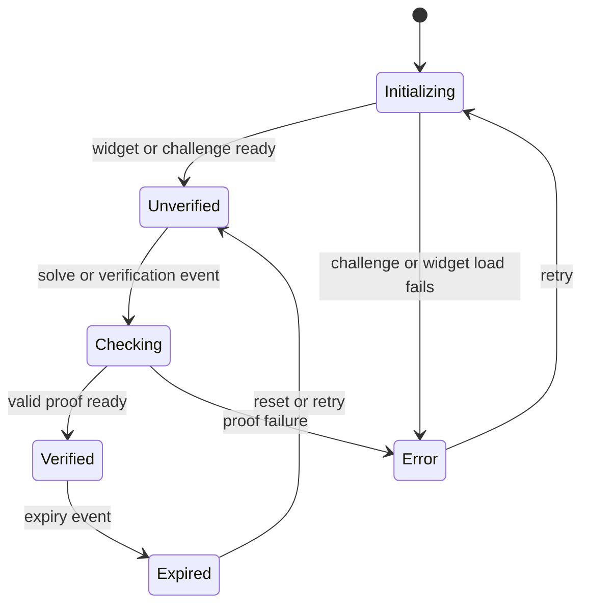

Visible text, hidden proof, readiness and widget lifecycle jointly represent state. Scope changes/unmount disposal prevent old async work from publishing readiness into a new action. Verified means a client proof is ready, not that a later protected request must succeed: B47 validates expiry/scope and consumes it once.

### F11 Support widget

**Owner:** [support provider](../src/components/support/support-chat-provider.tsx), [Tawk adapter](../src/lib/tawk.ts).

**Local/module:** loading promise, generation, connected/wanted/suppressed/bubble flags and resume callback. **External:** provider SDK and network.

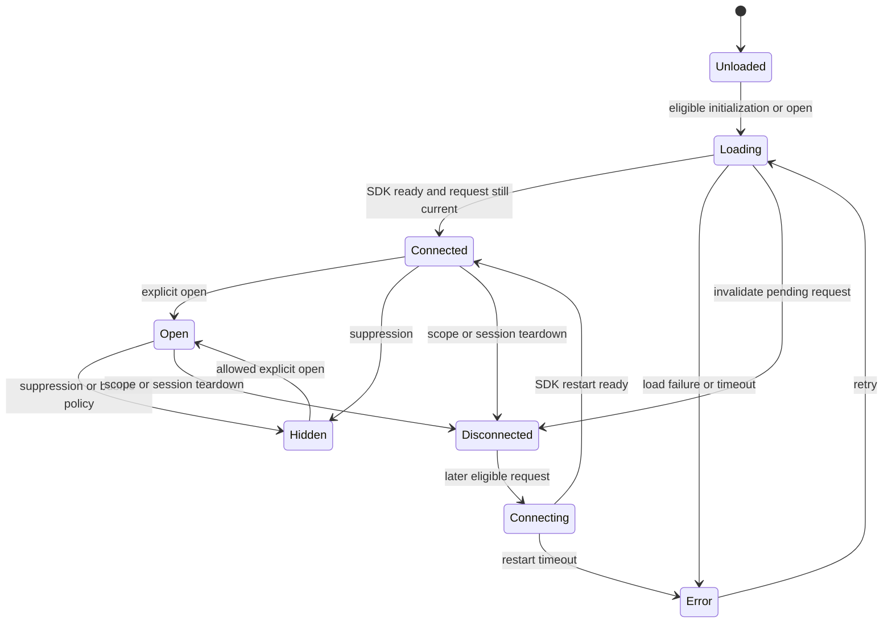

| Axis | Guard and effect |
| --- | --- |
| Eligibility | Provider derives availability from profile/role/scope; teardown occurs as eligibility changes. |
| SDK readiness | A shared promise avoids duplicate loads. Offline provider readiness can still expose its leave-a-message UI. |
| Teardown | Increment generation, clear wanted/connected, hide/end/logout/shutdown. Delayed load/restart callbacks must not reopen an obsolete session. |
| Visibility | Bubble and suppression are independent of connection. Hiding the widget is not equivalent to unloading or ending the chat. |
| Recovery | Error UI offers retry/direct support fallback. Restart readiness has a timeout. |

### F12 Assistant access and conversation

**Owner:** [AskBelivrHQ](../src/components/assistant/ask-belivrhq.tsx#L45). **Local:** access context/error/attempt, turns, pending, sequence ref and active AbortController.

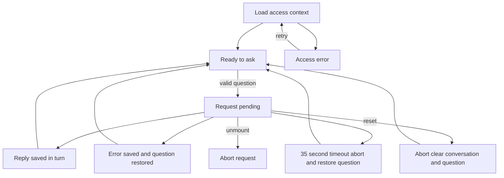

Sending requires context, no pending request/active controller and a trimmed question of 1 to 1200 characters. Response handlers ignore aborted work. Timeout clears pending state and preserves the question for retry. Reset aborts before clearing state. Drawer visibility is independent; simply closing it is not the same transition as reset or component unmount.

### F17 Live call confirmation

**Owner:** [LiveCallButton](../src/components/members/live-call-button.tsx), [server call entry](../../BelivrHQ-Backend/src/integrations/calls.controller.ts).

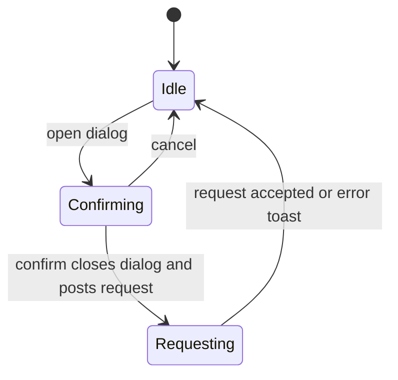

Permission and disabled/busy state govern the button. The component tracks the call-request lifecycle only. Server acceptance tells staff to answer their phone; the UI has no connected/completed-call state and no browser hang-up transition. Provider call progress must not be inferred from `busy=false`.

## Shared editing and batch patterns

### F13 Unsaved edits

**Owner:** [useUnsavedChanges](../src/hooks/use-unsaved-changes.ts). **Local/module:** dirty argument, per-instance symbol, active-draft Set and handled-link WeakSet.

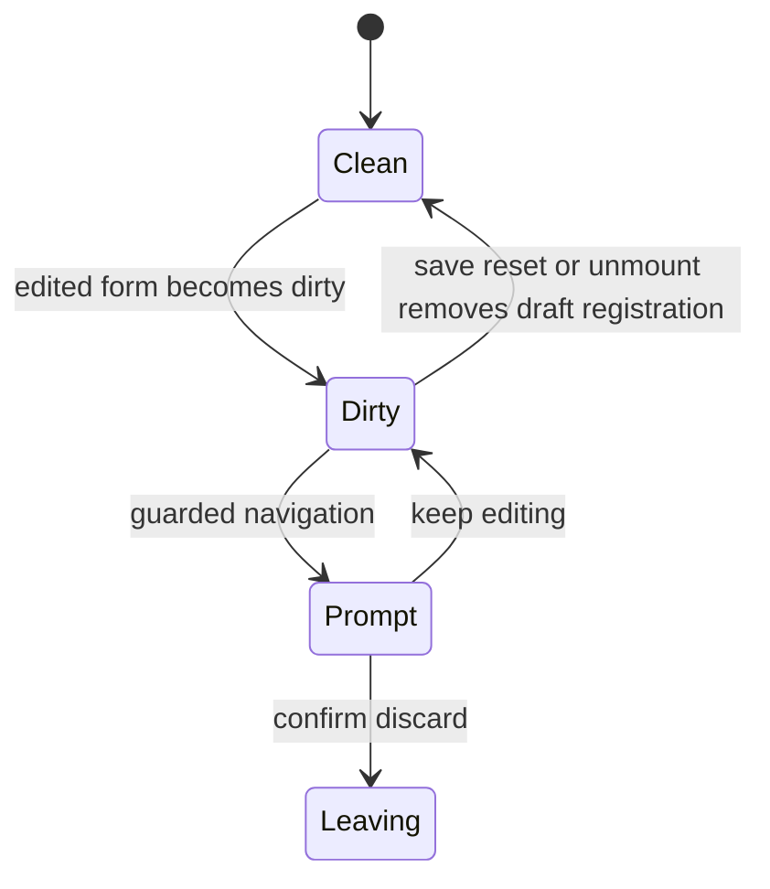

Dirty mounts register unload and link handlers. Drafts share the registry so one clean component does not erase another's dirty state. Link handling avoids duplicate prompts for the same event and ignores supported alternate/download/same-location navigation. `confirmDiscardChanges` is also available to explicit Back/Cancel buttons. Browser unload uses its native prompt; successful mutations can navigate through their own success path.

### F14 Shared dialogs mutation screens and exports

**Owner:** [manage confirmation](../src/components/shared/manage-confirmation.tsx), [record actions](../src/components/shared/record-actions.tsx), [export dropdown](../src/components/shared/export-dropdown.tsx).

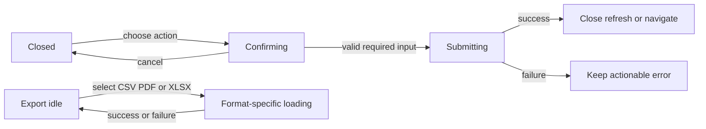

Record/action payload nullability encodes dialog identity. Pending queries/mutations encode submission state in many screens. Guards and dismissal behavior vary by component; this is a shared pattern, not a universal controller. Exports use a format-or-null loading value and their existing read/export grants. Table filters, search, pagination, selection, card/table mode and inspector open state are presentation state unless they drive a separately mapped workflow.

### F15 Bulk record management

**Owner:** [BulkManage](../src/components/shared/bulk-manage.tsx#L27). **Local:** selected rows, frozen batch, reason, busy state/ref, progress and failure list.

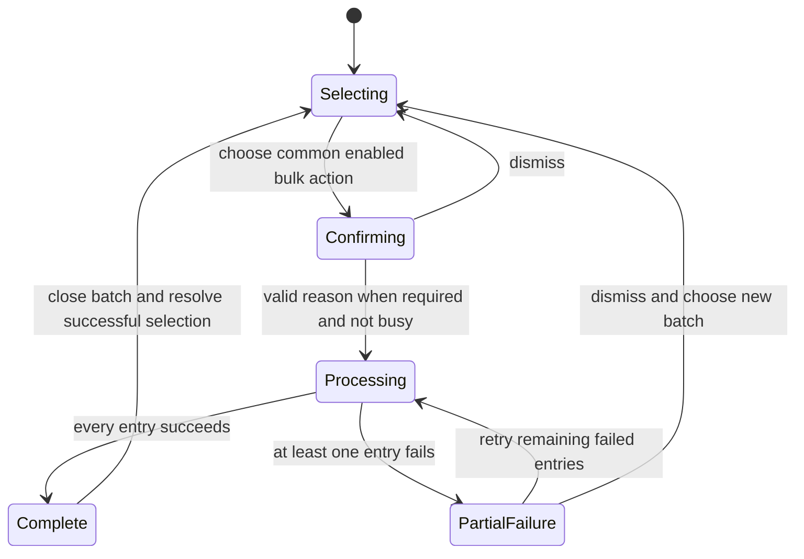

Each entry runs sequentially; exceptions are recorded per row and processing continues. `onResolved` removes successful IDs from selection. On partial failure the dialog replaces executable batch entries with only failures and retains their failure report. A retry therefore does not rerun successful entries. Remaining selection and executable batch are still separate state holders, but both discard successful IDs. A ref guards immediate duplicate run calls.

### F16 Attendance roster batch save

**Owner:** [MemberAttendanceRoster](../src/components/attendance/member-attendance-roster.tsx#L54). **Local:** editable, busy and selected Set; query props supply load/error state.

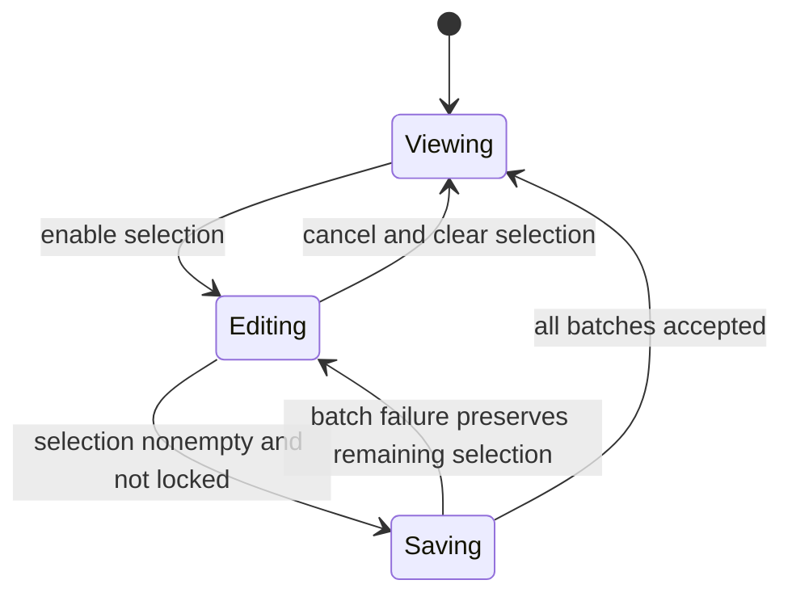

Save works in batches of 200. Each successful batch is removed from selection immediately; if a later batch fails, saved work remains saved and unsubmitted IDs stay selected. Successful completion disables editing. Search/paging preserve the selection Set. F15 also retains only failures, but operates one row at a time rather than in attendance batches.

## Offline workspace

### F18 Vault storage and offline lease

**Owner:** [OfflineVault](../src/lib/offline/vault.ts#L115), [assertLease](../src/lib/offline/engine.ts#L11), [workspace UI](../src/components/offline/offline-workspace.tsx).

**Durable:** encrypted IndexedDB envelope/revision, snapshot, outbox and drafts. **Local:** key/salt/owner, lockVersion and serialized update promise. The access lease is stored snapshot data and evaluated against current time/permissions.

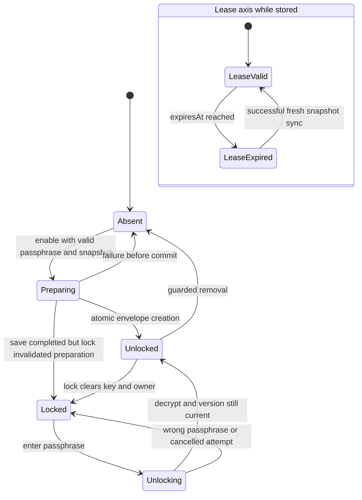

| Operation | Guard and effect |
| --- | --- |
| Enable | Passphrase at least 12 characters; no existing workspace; compare-and-swap creation. Lock version rejects stale preparation. |
| Unlock | Must decrypt current envelope and survive lock-version check. Incorrect passphrase does not delete stored data. |
| Update | Serialize local updates, preserve owner/church/branch, encrypt and compare-and-swap revision. A changed key prevents a save after locking. |
| Queue edit | Lease has offline read permission, valid issue/expiry times and acceptable clock skew; entity permission, prepared branch and outbox constraints also apply. |
| Remove | Unlocked; await outstanding writes; refuse drafts/outbox unless explicit discard flag is supplied. Successful deletion locks memory. |

Unlocked does not imply a valid access lease. Conversely, an expired lease does not erase pending data. Sync can obtain fresh permissions/lease without pretending an expired snapshot grants new edits.

### F19 Offline mutations and F20 synchronization flight

**Owner:** [engine](../src/lib/offline/engine.ts), [types](../src/lib/offline/types.ts), [server receipts B41](../../BelivrHQ-Backend/docs/STATE-MACHINES.md#b40-server-change-feed-and-b41-offline-mutation-receipts).

```mermaid
stateDiagram-v2
    state "F19 outbox item" as Item {
        [*] --> pending: queueMutation commits
        pending --> RemovedAccepted: accepted acknowledgement
        pending --> conflict: conflict acknowledgement
        pending --> rejected: rejected acknowledgement
        pending --> pending: retry or interrupted request
    }
    state "F20 sync flight" as Flight {
        [*] --> Idle
        Idle --> CheckingOwner: run
        CheckingOwner --> Pushing: profile and church match
        CheckingOwner --> Idle: identity mismatch or request error
        Pushing --> Downloading: batches processed
        Pushing --> Idle: retry acknowledgement or transport failure
        Downloading --> Committing: snapshot scope matches
        Downloading --> Idle: fetch error or scope mismatch
        Committing --> Idle: atomic snapshot and lease update
    }
```

| Transition | Guard and effect |
| --- | --- |
| Queue | Valid lease/branch/entity grant; no pending item for the same entity identity, no second queued submission for a form, maximum 500 entries. Commit encrypted workspace and outbox together. |
| Run | One in-flight promise per OfflineSync instance. Repeated run joins it. Sync is event-triggered; no idle polling timer. |
| Push | Sequential batches of 25. Ack set must exactly match submitted IDs; malformed/incomplete response retains pending data. |
| Accept | Apply accepted person changes/version into local records before removing outbox item, so a later failed download does not lose accepted data. |
| Conflict/reject | Retain item and message; only pending entries are sent by subsequent automatic runs. No automatic conflict/rejected-to-pending edge exists in this engine. |
| Retry | Keep pending; stop the flight with a retryable error after durably applying acknowledgements. |
| Snapshot | Verify profile/church/branch; atomically replace server records/lease while retaining current outbox and drafts. Release flight promise in finally on both success and failure. |

The server receipt prevents duplicate effects after a lost response. Local optimistic visible records overlay all retained outbox entries; a rejected/conflicting overlay is still local data awaiting review, not accepted server truth.

### F21 Service worker and offline navigation

**Owner:** [sw.ts](../src/app/sw.ts). **Library-managed:** install, activate and controlling clients. **Durable:** permitted asset caches.

```mermaid
flowchart TD
    Install[Install precache] --> Activate[Activate skip waiting and claim clients]
    Activate --> Purge[Remove legacy API pages RSC and other private caches]
    Activate --> Control[Control fetches]
    Control --> Private[API authenticated RSC and document requests]
    Private --> Network[Network only]
    Network -->|document navigation fails| Offline[Offline page fallback]
    Control --> Assets[Allowed same-origin asset caching and explicit font hosts]
    Control --> External[Other cross-origin requests bypass caching]
```

The worker does not cache private API/dashboard responses as an offline database. Encrypted F18 storage is the offline business workspace. Asset caching policy and navigation fallback are distinct from user authorization. Install/activation mechanics belong to Serwist/browser lifecycle; this map covers application configuration rather than reimplementing those library states.

## Cross-system interpretation

| Browser observation | Authoritative interpretation |
| --- | --- |
| Login mutation returned a challenge | B42/B43 must complete; F01 is not yet an ordinary authenticated session. |
| Popup returned successful or another tab published a hint | Reverify B01/B03/B08. A return parameter is not proof of access. |
| Upload progress completed | The object may exist, but B46 metadata completion can still fail. |
| Bulk dialog reported partial failure | F15 retries only retained failed rows. F16 removes successful attendance batches immediately. |
| Sync push succeeded but snapshot fetch failed | Accepted local records and receipt-backed effects persist; lease renewal may still be incomplete. |
| Call request ended or chat SDK became ready | Neither proves a telephone connection or a live support-agent response. |

These maps preserve the implemented flow, including direct-edit and retry semantics. They are documentation only; no state library, runtime refactor or new transition restriction is introduced.
