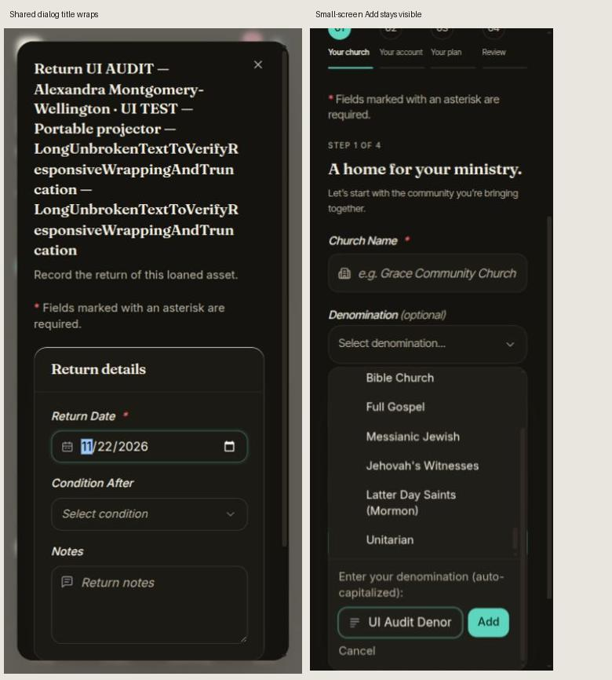

# Shared dialog and denomination fixes — 22 November 2026

Resolved the three findings in the [dialog follow-up review](ui-dialog-followup-2026-11-22.md).

## Changes

- Shared dialog headers, titles and descriptions now constrain their width and wrap unbroken text. Long record names remain complete without horizontal scrolling; ordinary titles retain their existing styling.
- The custom denomination Add button uses `bg-primary` and `text-primary-foreground`, so its label follows the theme's contrasting foreground instead of hardcoded white.
- The denomination popover uses the trigger's actual CSS-variable width, capped by the viewport and Radix's available space. Height is bounded with vertical scrolling. Its custom input can shrink, and Add retains its width inside the row.

Application changes are limited to `src/components/ui/dialog.tsx` and `src/components/shared/denomination-combobox.tsx`. No form submission, account, loan or API behavior changed.

## Verification

The final production build passed, including lint/type checks and all **114 generated pages**. Scoped ESLint and whitespace checks passed. All **847 unit tests in 75 files passed**. [Test output](evidence/ui-dialog-fixes-2026-11-22/unit-tests.log).

**18 browser layout states passed:**

| Scenario | Widths / heights | Themes | Checks |
| --- | --- | --- | ---: |
| Return dialog with valid long asset name | 1280×900, 390×844, 320×844 | Light/dark | 6 |
| Return dialog with existing ordinary name | 1280×900, 390×844 | Light/dark | 4 |
| Custom denomination control | 1280×900, 390×844, 320×844, 320×568 | Light/dark | 8 |

The long title's scroll width now equals its client width: **393px desktop, 268px at 390px, 198px at 320px**. Each dialog's scroll width also equals its client width. No duplicate required asterisks were observed. [Long-dialog measurements](evidence/ui-dialog-fixes-2026-11-22/dialog-views.json) · [Ordinary-dialog measurements](evidence/ui-dialog-fixes-2026-11-22/ordinary-dialog-views.json).

At 320px, the denomination popover stays between approximately **24px and 286px**, and Add stays between **208px and 262px**. Add's bottom edge remains within the short 568px viewport, at approximately **524px**. The popover has no internal horizontal overflow. [Dropdown measurements](evidence/ui-dialog-fixes-2026-11-22/denomination-views.json).

In the tested default palette, the enabled Add label's calculated contrast is approximately **5.20:1 in light mode** and **9.07:1 in dark mode**, improved from the previous dark-mode 1.79:1. The measured dark colors are `rgb(7,37,31)` on `rgb(94,213,190)`.

**32 local control interactions passed:** for all eight denomination viewport/theme cases, custom text was selected using Add or Enter, an existing denomination was found through search and selected, Cancel discarded custom entry without changing the selected value, and Escape closed the popover and restored focus to its trigger. Add remained disabled when custom entry was blank and enabled after text entry. [Action results](evidence/ui-dialog-fixes-2026-11-22/actions.json).

## Evidence and scope

[Long title on desktop](evidence/ui-dialog-fixes-2026-11-22/return-light-1280.jpg) · [Dropdown on a short 320px screen](evidence/ui-dialog-fixes-2026-11-22/denomination-dark-320x568.jpg).

Normal loan data came from the signed-in local app. The long name came from a read-only loopback fixture. Registration controls were tested in an anonymous read-only preview; selection changed only local form state. No loan return was confirmed, no registration step was submitted, and no agreement, credentials or account records were created or changed. This verifies responsive browser behavior rather than physical-device/cross-engine behavior or every custom color palette.

Temporary fixtures were stopped. The browser remains open on the real asset register in light mode with its viewport override reset. The frontend and API remain running. Nothing was committed or deployed.
