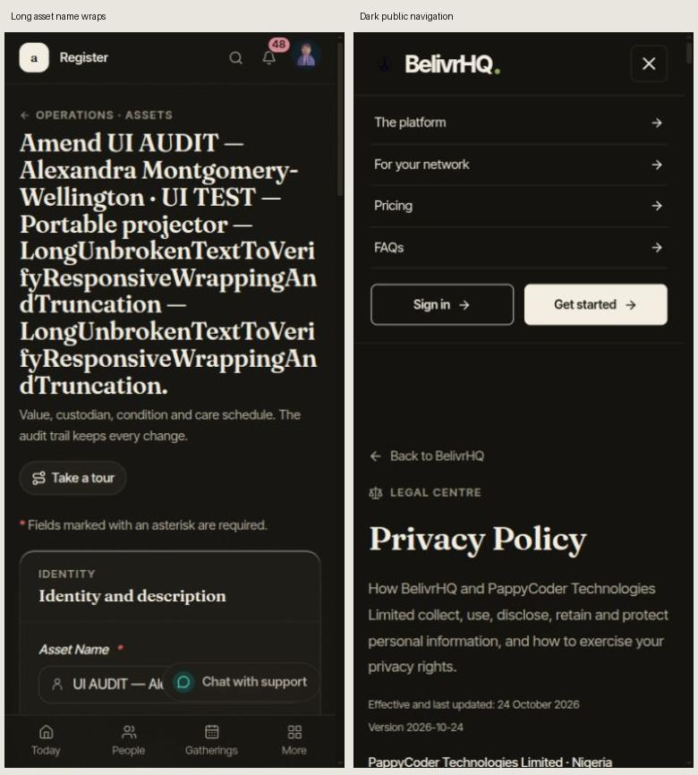

# Four UI consistency fixes — 22 November 2026

Resolved the four findings from the [comprehensive route audit](ui-comprehensive-audit-2026-11-21.md).

## Changes

- **Asset failure handling:** `/operations/assets` now checks the query error before loading/empty/data branches and renders the shared `ErrorState`. A failed request no longer claims the register is empty or offers to register the first asset. “Try again” uses the existing session-aware full-page retry: recoverable sessions reload; confirmed unrecoverable sessions clear authentication and return to login.
- **Long record text:** shared detail/page/section headings constrain their width and wrap unbroken text with `overflow-wrap:anywhere`. This also fixes edit/create preview titles. Asset detail content inherits the same wrapping so long descriptions and notes stay within the viewport. Full names remain available rather than being truncated.
- **Public header contrast:** `PublicPaperShell` explicitly selects a Paper variant of `MarketingNavigation`. Its header background, foreground, border, hover and CTA text use the current Paper theme tokens. The landing page retains its existing marketing variant.
- **Public navigation:** desktop and mobile platform/network/pricing/FAQ links use `/#product`, `/#enterprise`, `/#pricing` and `/#questions` through Next Link. They now reach the landing-page sections from other public pages.

## Validation

- All **843 unit tests in 74 files passed**, including session-aware retry cases for valid, recoverable, expired and temporarily unavailable sessions.
- Scoped ESLint and whitespace checks passed for the changed source. The final production build passed lint/type checks and generated all **114 pages**. One earlier overlapping build attempt failed while collecting generated trace files; the final build was run to completion before restarting the preview.
- **44 final viewport/theme observations** passed: no document overflow, mismatched viewport/theme, unsettled screenshot dimensions or duplicate required labels. [Coverage CSV](evidence/ui-four-fixes-2026-11-22/viewport-checks.csv).
- Desktop **1280×900** and mobile **390×844**, light/dark: asset failure and recovered register, long asset detail/edit, existing member register, privacy, help, offline-unavailable and authenticated payment-return shell.
- Additional **320×844**, light/dark: long asset detail/edit/preview and expanded public navigation. Long H1/preview H2 scroll widths equal their client widths. [Bounds](evidence/ui-four-fixes-2026-11-22/small-phone.json).
- All **16 navigation activations** passed: four public links × desktop/mobile × light/dark. Each opened `/` with the correct fragment, a real target in view and no document overflow. [Navigation results](evidence/ui-four-fixes-2026-11-22/navigation.json).
- Failure recovery: after the fixture stopped returning 503, activating “Try again” fully reloaded the register and restored its existing asset; the error and false-empty message were absent. [Recovery result](evidence/ui-four-fixes-2026-11-22/retry-result.json).
- Public mobile menus were opened and visually inspected. In dark mode the header is dark with pale controls, and its pale CTA has dark text; light mode reverses these appropriately. [Computed colors](evidence/ui-four-fixes-2026-11-22/header-colors.json).

## Evidence and scope

[Asset error state on desktop](evidence/ui-four-fixes-2026-11-22/asset-error-desktop.jpg).

Tests used the final local production build with existing authenticated records. Synthetic failures and long text came from temporary GET/HEAD-only loopback proxies; no business records, payments, credentials or permissions were changed. Payment-return testing exercised its shell without a transaction. Expired-session behavior was covered by the existing unit tests, without invalidating the user's real session. Responsive viewport checks do not substitute for physical-device/cross-engine testing or a new exhaustive audit of every app interaction.

The temporary proxies were stopped. The signed-in browser was left on the real asset register in light mode with its viewport override reset. The frontend/API remain running; nothing was deployed or committed.
