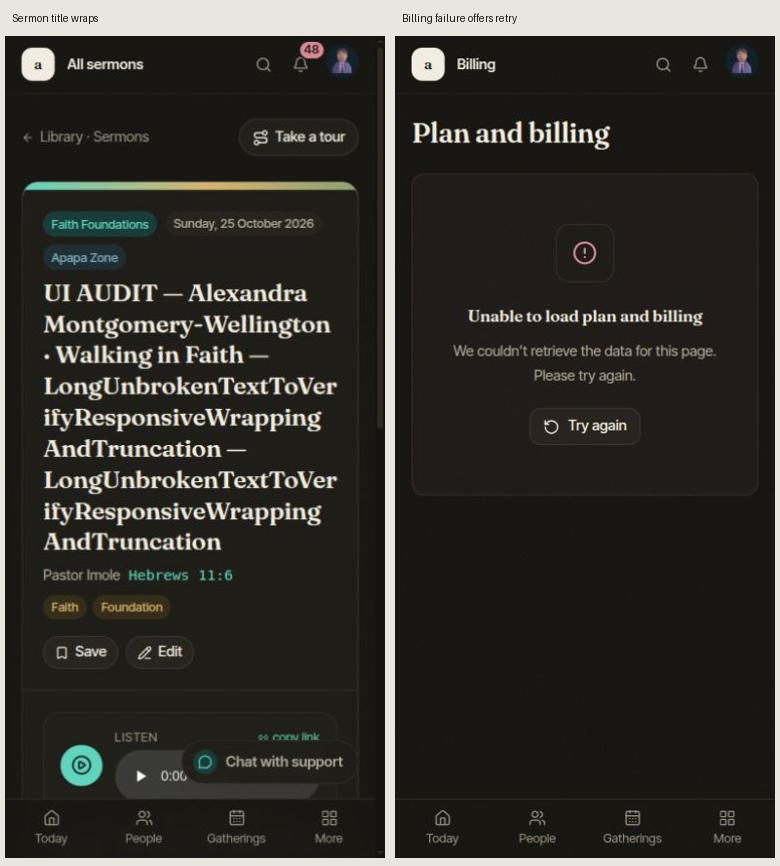

# Remaining UI fixes and verification — 22 November 2026

Resolved all three issue groups in the [follow-up audit](ui-post-fixes-audit-2026-11-22.md), including failure handling on every affected route.

## Changes

**Sermon detail titles:** the local H1 now constrains its width and wraps unbroken text. The full 177-character test title remains visible. Its scroll width equals its client width at desktop, 390px and 320px in both themes: 1065/1065px, 302/302px and 232/232px respectively. [Measured bounds](evidence/ui-three-fixes-2026-11-22/title-bounds.json).

**Failure states across all 18 affected routes:** `PageQueryError` supplies the shared heading, accessible error feedback and session-aware full-page “Try again” action. Failed required reads are checked after hooks and before rendering derived totals or empty guidance. Permission-disabled queries remain excluded from relevant combined checks.

| Area | Affected routes fixed |
| --- | --- |
| Assets and giving | `/operations/assets/categories`, `/giving/funds`, `/giving/statements` |
| Sermon registers | `/library/sermons/series`, `/library/sermons/speakers` |
| People and care | `/people/segments`, `/people/pastoral/engagement`, `/people/pastoral/care` |
| Appointments | `/connect/appointments` |
| Attendance | `/gatherings/attendance`, `/gatherings/attendance/reports` |
| Media | `/library/media/folders` |
| Administration | `/admin/locations`, `/admin/permissions`, `/admin/team`, `/admin/locations/[branchId]` |
| Dashboard and calendar | `/home`, `/gatherings/events` |

Home handles members, giving, notifications and gatherings independently. A failed source shows an explicit **Unavailable** metric and an error/retry card, while healthy sections remain visible. Shared stat cards omit stale numeric values, currency, percentage changes and footers when unavailable. Successful zero values still render numerically.

Branch details use the existing scoped single-record endpoint instead of searching two limited list pages. Server/network failures show recovery feedback; a genuine 404 retains the missing-record state and back link. Failed refreshes discard the cached record from the displayed view, including when a previously available record becomes missing. Existing branch mutation cache handling remains in place.

**Billing:** after the existing access checks, failed billing reads now render an explicit error page before the loading/no-data branch. Successful empty payment histories retain their existing presentation. The retry action uses the shared session-aware reload behavior.

## Verification

- **847 unit tests in 75 files passed.** Added billing failure/stale-data tests and stat-card tests that distinguish unavailable metrics from legitimate zero values. [Test output](evidence/ui-three-fixes-2026-11-22/unit-tests.log).
- Scoped ESLint, TypeScript and whitespace checks passed. Final production build passed lint/types and generated all **114 pages**. An earlier build caught the numeric stat-card type constraint; the explicit unavailable state corrected it before final validation.
- The repository UI-contract audit found **no issues across 104 page templates**. [Audit output](evidence/ui-three-fixes-2026-11-22/ui-contract-audit.log).
- **198 deduplicated browser observations passed** with matching viewport/theme, bounded document widths and settled screenshot dimensions. No duplicate required labels were observed. [Full state/viewport coverage CSV](evidence/ui-three-fixes-2026-11-22/views.csv).

| Browser scenario | Observations | Result |
| --- | ---: | --- |
| Failed reads on all 18 affected routes plus billing | 76 | Error/retry feedback on each page; no persistent skeletons. Home shows four unavailable metrics and four error cards. |
| Normal reads on those same 19 routes | 76 | Normal populated or legitimately empty content; no error/unavailable indicators. |
| Long sermon title | 6 | Fits at 1280, 390 and 320px, light/dark; no H1 clipping. |
| Giving-only and notifications-only dashboard failures | 8 | One unavailable metric/error section; remaining sources stay visible. |
| Successful empty asset categories, giving categories, series, speakers, appointments and media folders | 24 | Normal empty states remain; no failure indicators. |
| Genuine missing branch | 4 | Missing-record state retained; no server-failure message. |
| Billing after recovery | 4 | Actual retry reloaded the page and restored billing data without an error or skeletons. |

The four standard combinations are **1280×900 / 390×844**, each in light/dark. An additional 320×844 pair covers long titles. The final cached-branch adjustment was built successfully and its successful, failed and 404 states were rechecked afterward in all four combinations. Screenshot review covered the error states, populated comparisons, empty states and partial-dashboard states.

Billing recovery was exercised by switching the read-only fixture from 503 to successful reads and activating “Try again.” The normal billing heading returned with zero alerts and zero skeletons. [Recovery result](evidence/ui-three-fixes-2026-11-22/retry-result.json). Session-expiry handling remains covered by the existing retry unit tests; the user's live session was not invalidated.

## Evidence and scope

[Giving error on desktop](evidence/ui-three-fixes-2026-11-22/giving-error-desktop.jpg) · [Dashboard with only giving unavailable](evidence/ui-three-fixes-2026-11-22/partial-dashboard-mobile-dark.jpg).

The production preview and existing records were used for normal states. GET/HEAD-only loopback proxies supplied synthetic failures, empty data, long text and a missing record. Their logs recorded no attempted writes. No records, payments, credentials, messages or permissions were changed. These are responsive-browser checks, not physical-device/cross-engine tests or proof of every possible app interaction.

Temporary fixtures were stopped. The browser remains open on the real asset register in light mode with its viewport override reset. The frontend and API remain running. Nothing was committed or deployed.
